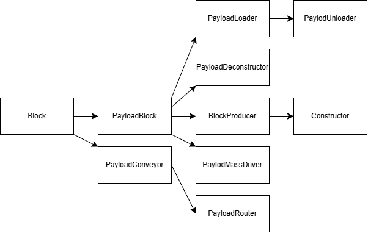

# 载荷方块

> 本篇作者: pardon

我不建议将本篇看作单独的教程，而是作为参考答案，来检验你阅读、理解的java代码是否正确.

载荷方块，我们通常认为指的是*载荷传送带(PayloadConveyor)*、*载荷路由器(PayloadRouter)*、*构造器(Constructor)*、*解构器(PayloadDeconstructor)*、*装载器(PayloadLoader)*、*卸载器(PayloadUnloader)*和*载荷质量驱动器(PayloadMassDriver)*这七种类型的方块.

这七种类型及相关类的继承关系如下图所示(箭头表示继承).

## PayloadConveyor和PayloadRouter

这两*不继承PayloadBlock*,我们先介绍它们.

### PayloadConveyor 类

| 键 | 类型 | 默认值 | 说明 |
| --- | --- | --- | --- |
| moveTime | number | 45 | 载荷移动所需时间（帧） |
| moveForce | number | 201 | 推动单位的力度 |
| payloadLimit | number | 3 | 可承载载荷的最大尺寸（格） |
| pushUnits | boolean | true | 是否推动踩在上面的单位 |
| topRegion | string | name + "-top" | 顶部贴图 |
| edgeRegion | string | name + "-edge" | 边缘贴图 |

### PayloadRouter 类

| 键 | 类型 | 默认值 | 说明 |
| --- | --- | --- | --- |
| invert | boolean | false | false时类似分类器,true时类似反向分类器 |
| overRegion | string | name + "-over" | 覆盖层贴图（绘制在顶部） |

## PayloadBlock类

*PayloadBlock*定义了载荷方块的基本属性和行为,如果我们使用的是java或者js的话,你能在其中发现很多载荷方块的通用方法,不过我们这里是json,可调整的参数不多.

以下是PayloadBlock类的主要参数:

| 键 | 类型 | 默认值 | 说明 |
| --- | --- | --- | --- |
| payloadSpeed | number | 0.7 | 载荷在方块中的移动速度 |
| payloadRotateSpeed | number | 5 | 载荷在方块中的旋转速度 |
| regionSuffix | string | "" | 贴图后缀 |
| topRegion | string | name + "-top" | 顶部贴图 |
| outRegion | string | name + "-in" | 输入贴图 |
| inRegion | string | name + "-out" | 输出贴图 |

以上的接口,对于继承*PayloadBlock*类的子类方块都是适用的.

### BlockProducer 类

| 键 | 类型 | 默认值 | 说明 |
| --- | --- | --- | --- |
| buildSpeed | number | 0.4 | 建造速度倍率 |

> 来自 PayloadBlock 的参数（如 payloadSpeed、payloadRotateSpeed、regionSuffix 等）同样可用。

#### Constructor 类

|键|类型|默认值|说明|
|---|---|---|---|
|filter|array|[]|可生产的方块（空表示无限制）|
|minBlockSize|number|1|可生产方块的最小尺寸（格）|
|maxBlockSize|number|2|可生产方块的最大尺寸（格）|

> 来自 BlockProducer 的 buildSpeed 以及 PayloadBlock 的全部参数均生效。

### PayloadDeconstructor 类

|键|类型|默认值|说明|
|---|---|---|---|
|maxPayloadSize|number|4|可分解载荷的最大尺寸（格）|
|deconstructSpeed|number|2.5|分解速度倍率|
|dumpRate|number|4|每帧输出物品的次数|

> 来自 PayloadBlock 的参数（如 payloadSpeed，该方块构造中设为 1.0）同样生效。

### PayloadLoader 类

|键|类型|默认值|说明|
|---|---|---|---|
|loadTime|number|2|每次装载操作的间隔时间（帧）|
|itemsLoaded|number|8|每次装载时转移的物品数量|
|liquidsLoaded|number|40|每次装载时转移的液体量（单位）|
|maxBlockSize|number|3|可装载方块的最大尺寸（格）|
|maxPowerConsumption|number|40|满载时的额外功率消耗|
|loadPowerDynamic|boolean|true|是否根据负载动态调整功率消耗|
|overRegion|string|name + "-over"|覆盖层贴图|

> 来自 PayloadBlock 的参数同样生效

#### PayloadUnloader 类

|键|类型|默认值|说明|
|---|---|---|---|
|offloadSpeed|number|4|每帧输出物品的次数|
|maxPowerUnload|number|80|每帧最大输出功率（从电池中卸载）|

> 来自 PayloadLoader 的全部参数（如 loadTime、itemsLoaded、liquidsLoaded 等）以及 PayloadBlock 的参数均生效。

### PayloadMassDriver 类

|键|类型|默认值|说明|
|---|---|---|---|
|range|number|100|射程|
|rotateSpeed|number|5|炮塔旋转速度（度/帧）|
|length|number|11.125|炮管长度（世界单位）|
|knockback|number|5|后坐力位移量|
|reload|number|30|装填冷却时间（帧）|
|chargeTime|number|100|充能时间(帧)|
|maxPayloadSize|number|3|可发射载荷的最大尺寸（格）|
|grabWidth|number|8|抓取宽度|
|grabHeight|number|2.75|抓取高度|
|baseRegion|string|name + "-base"|底座贴图|
|capRegion|string|name + "-cap"|炮管末端贴图|
|leftRegion|string|name + "-left"|左侧臂贴图|
|rightRegion|string|name + "-right"|右侧臂贴图|
|capOutlineRegion|string|name + "-cap-outline"|炮管末端轮廓贴图|
|leftOutlineRegion|string|name + "-left-outline"|左侧臂轮廓贴图|
|rightOutlineRegion|string|name + "-right-outline"|右侧臂轮廓贴图|
|arrow|string|"bridge-arrow"|瞄准箭头贴图|

> 来自 PayloadBlock 的参数同样生效
